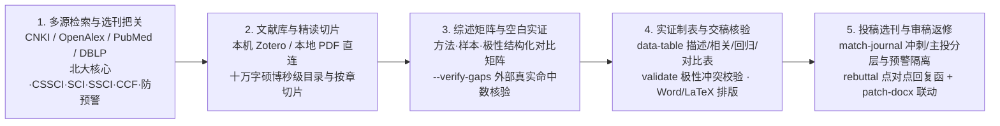

# Scholar Kit

**中文** | [English](README_EN.md)

[](https://github.com/lottshin/scholar-kit/actions/workflows/ci.yml)
[](https://github.com/lottshin/scholar-kit/actions/workflows/upstream-smoke.yml)
[](https://github.com/lottshin/scholar-kit/releases)
[](https://www.python.org/)
[](LICENSE)

面向科研全流程的学术文献检索、实证制表、写作核验与投稿返修 AI Skill。覆盖 **中英文多源检索与预警筛查 → 硕博精读与本地文献库联动 → 结构化对比矩阵与外部空白实证 → 实证三线表/LaTeX 制表与论断极性核验 → 投稿目标选刊与审稿意见点对点返修**，由确定性 Python 脚本负责检索、统计、核验与排版，Agent 负责学术理解与论证写作。

兼容 **Claude Code**、**Codex**、**Cursor**、**Antigravity**、**Gemini CLI** 等支持 `SKILL.md` 规范的 AI Agent。



---

## 快速安装

### 方式一：CLI 一键安装（推荐，兼容主流 Agent Skills 生态）

```bash
npx skills add lottshin/scholar-kit
```

### 方式二：一句话自然语言安装（所有平台通用）

在任意 Agent 对话框直接发送：

```text
Fetch and follow instructions from https://raw.githubusercontent.com/lottshin/scholar-kit/main/setup.md
```

### 方式三：手动 Git 安装

<details>
<summary>展开各平台手动安装步骤</summary>

```bash
# Claude Code
git clone https://github.com/lottshin/scholar-kit ~/.claude/skills/scholar-kit

# Codex
git clone https://github.com/lottshin/scholar-kit ~/.codex/skills/scholar-kit

# Antigravity（全局或工作区）
git clone https://github.com/lottshin/scholar-kit ~/.gemini/config/skills/scholar-kit
# 或工作区内: git clone https://github.com/lottshin/scholar-kit .agents/skills/scholar-kit

# Cursor — macOS / Linux
git clone https://github.com/lottshin/scholar-kit ~/.cursor/skills/scholar-kit

# Cursor — Windows (PowerShell)
git clone https://github.com/lottshin/scholar-kit "$env:USERPROFILE\.cursor\skills\scholar-kit"

# Gemini CLI
gemini skills install https://github.com/lottshin/scholar-kit.git

# 多 Agent 共用建议：保留一份主仓库（如 ~/.agents/skills/scholar-kit），其余目录用 ln -s 软链接指向它

# 安装依赖并自检（兼容 PEP 668 受管环境，必要时自动引导 ~/.scholar-kit/.venv）
python3 -m pip install -r <安装路径>/scripts/requirements.txt
python3 <安装路径>/scripts/literature.py check --fix
```

</details>

---

## 怎么使用

安装后无需记忆命令行参数，直接用自然语言向 Agent 提需求：

```text
# 检索与下载
"帮我搜索近五年关于新质生产力的 CSSCI 论文，挑前 10 篇下载 PDF"
"在 PubMed 搜一下 CRISPR-Cas9 临床试验的高被引综述"

# 个人文献库联动（Zotero / 本地 PDF）
"从我电脑的 Zotero「博士论文」集合里找出所有数字经济文献，整理一份对比矩阵"
"把 ./mypapers 文件夹里的 PDF 导入课题库，写一段研究评述"

# 引文滚雪球与文献综述
"查一下赵涛《数字经济、创业活跃度与高质量发展》的引证文献和同被引文献"
"围绕这批文献生成文献综述初稿，并校验每一处引用是否有原文支撑"

# 实证数据制表（描述统计 / 相关矩阵 / 回归三线表 / 实验对比表）
"把 panel_data.csv 生成带显著性星号的相关系数矩阵和描述性统计三线表，导出 Word 和 LaTeX"
"把实验结果 benchmark.csv 转成 LaTeX booktabs 对比表，自动加粗最优指标、下划线次优指标"

# 参考文献纠偏、补页码与导出
"核对一下我文末这批中文参考文献，补齐漏掉的页码，顺便检查有没有改名搜不到的文献"
"按正文引用顺序导出 GB/T 7714 参考文献和兼容 pdflatex 的 BibTeX"

# 文稿润色、投稿选刊与审稿返修
"读取我的 draft.docx，按学术规范优化表达、去掉 AI 腔，确认无误后写回 Word"
"根据我这篇论文引用的文献分布，推荐冲刺刊和主投核心期刊，排除中科院预警期刊"
"把审稿意见 reviewers.txt 拆解成点对点回复函，定位到原稿对应段落并生成修订补丁"
```

---

## 真实输出预览

以下是脚本在真实数据与实网 OpenAlex 环境下的确定性输出示例：

<details open>
<summary><strong>1. 实证回归三线表（<code>data-table --type regression</code> → 同步输出 Markdown / LaTeX booktabs / Word 三线表）</strong></summary>

表 3  数字化转型对企业全要素生产率的基准回归与稳健性检验

| 变量 | (1) Baseline OLS | (2) IV-2SLS | (3) PSM-DID |
| --- | ---: | ---: | ---: |
| Digital_Trans | 0.1426*** | 0.1685*** | 0.1358*** |
|  | (0.0312) | (0.0485) | (0.0341) |
| Firm_Size | 0.0834*** | 0.0791*** | 0.0812*** |
|  | (0.0215) | (0.0209) | (0.0224) |
| Leverage | -0.1942*** | -0.2105*** | -0.1870*** |
|  | (0.0748) | (0.0812) | (0.0785) |
| Firm FE / Year FE | Yes | Yes | Yes |
| 观测值 (N) | 18420 | 18420 | 14210 |
| R² / Adj. R² | 0.2840 | 0.3170 | 0.3310 |

> 注：圆括号内为稳健标准误；***、**、* 分别表示在 1%、5%、10% 水平上显著。同时自动生成可直接编译的 LaTeX `booktabs` 代码与 A4 版心全宽原生 Word 三线表（`.docx`）。

</details>

<details>
<summary><strong>2. 外部空白实证核验 &amp; 结论极性/统计幻觉拦截（<code>review --verify-gaps</code> + <code>validate</code>）</strong></summary>

```json
// review --verify-gaps 实时检索 OpenAlex，阻止把"当前库没搜到"误写为"学界空白"
{
  "dimension": "方法支撑",
  "search_proof": {
    "database": "OpenAlex",
    "query": "digital transformation firm productivity empirical experiment",
    "year_range": "2022-2026",
    "total_hits": 31391,
    "verdict": "already_crowded"
  }
}

// validate 核查 .docx/.md 成稿：精准抓出"结论写反"与"无引文裸统计数据"
{
  "status": "warning",
  "issues": [
    {
      "type": "polarity_conflict",
      "note": "正文表述为正向促进，但所引文献原文核心结论为负向/倒U型门槛效应（contradicted）"
    },
    {
      "type": "unbacked_statistics",
      "note": "检测到未挂引文的统计数值（如 73.6%, p < 0.01），请核实是否来自真实一手数据"
    }
  ]
}
```

</details>

<details>
<summary><strong>3. 投稿选刊分层避雷 &amp; 审稿返修补丁联动（<code>match-journal</code> + <code>rebuttal</code>）</strong></summary>

- **`match-journal`**：聚合文稿/课题引文母刊并结合 30,300+ 条离线核心索引，分为 **冲刺顶刊（Tier 1）** / **主投高契合核心（Tier 2）** / **稳健拓展核心（Tier 3）**；自动将中科院在榜预警期刊（如 *Computers and Electrical Engineering*）隔离至 `excluded_warning_venues`，对曾上榜已调出期刊附加历史谨慎提示。
- **`rebuttal`**：自动解析 `Editor` / `Reviewer #N` / `审稿专家` 意见为 `R1-C1`、`R1-C2`...，自动匹配原稿对应段落 `[P2]`、`[P5]`，一键生成中/英文 **Response Letter（.docx / .md）** 与可直接通过 `patch-docx --dry-run` 预检的原稿修订补丁 JSON。

</details>

---

## 核心能力（按科研工作流）

### 1. 多源文献检索与深层引文网络
- **知网深度检索**：支持 KNS8S 专业布尔检索式（`--expr` / `--professional`）与可重复结构化高级条件（`--condition` 最多 10 项，自动加括号保护 `AND/OR/NOT` 同级运算）、中英文扩展显式开关（`--cross-language on/off`）及结果页检索式回读核验（`retrieval.verified`）；支持篇关摘、第一作者、机构、基金、精确/模糊刊名、北大核心/CSSCI/CSCD/EI 等核心筛选、单页 50 条高吞吐与按下载量排序；内置本地浏览器常驻热复用与代理回环绕行。
- **国际与专业开放源并发 + 离线分区/预警识别**：支持单源检索、无结果自动降级（Fallback）及全源异步并发检索；内置 30,300+ 条 ISSN 离线索引，自动识别 **SCI / SSCI / A&HCI / ESCI、CCF-A/B/C（2026 第七版）及中科院《国际期刊预警名单》**（支持 `--core SCI,SSCI,CCF-A` 与 `--exclude-warning` 一键防踩雷）。
- **双向与共引图谱（滚雪球）**：中文论文可直接按知网链接或题名抓取**引证文献、参考文献、共引文献与同被引文献**；英文/DOI/arXiv 论文接入 Semantic Scholar 引文网络，检索结果可一键追加至课题库。

### 2. 全文下载与个人文献库管理
- **防风控批量下载**：支持知网 PDF/CAJ 分批并发下载、断点续传与格式严格分目录存放（可显式开启 CAJ 兜底，绝不静默混放），英文开放获取（OA）论文通过 Unpaywall 自动拉取，下载完成后自动生成排版清单。
- **本机 Zotero 与本地 PDF 零依赖直连**：自动以只读快照读取本机 `zotero.sqlite`（Zotero 运行中也不锁库）并关联本地 `storage/*.pdf` 附件；支持直接扫描导入本地 PDF 文件夹或 NoteExpress / Refworks / BibTeX 题录。
- **课题级文献库治理**：按课题隔离维护文献池，支持剔除噪声、精选留存、跨轮去重及阅读标签/批注沉淀。

### 3. 全文精读、结构化对比矩阵与深度核查
- **本地优先全文与硕博长文按章切片**：知网检索阶段自动通过隐藏内联帧批量导出完整摘要与页码；已下载或 Zotero 关联的本地 PDF 直接离线秒级提取带页码正文（免网页滑块）；支持 1.5 秒级提取十万字硕博论文的完整章节目录（`--toc`），并按标题或章号精准切片精读（如 `--section "研究设计,实证分析"`）。
- **结构化对比矩阵与外部空白实证**：`review` 自动抽取每篇文献的**研究方法、样本区间、核心结论句与效应极性（正向/负向/倒U型/不显著）**生成对比矩阵，自动提示同一主题下的学界正负向结论争鸣；叠加 `--verify-gaps` 自动向外部数据库发起实时检索计数核验，附带真实命中篇数证明并拦截“伪空白”。
- **极性冲突与统计归属校验（`validate`）**：支持直接传入 `.md / .docx / .pdf` 成稿，除逐句核查引用支撑度外，自动捕获**把原文负向/倒 U 型结论写反正向**（`polarity_conflict`）、**著者-出版年年份错位**（`year_mismatch`）及**无一手数据声明却凭空出现的样本量/显著性数字**（`unbacked_statistics`）。

### 4. 实证制表、标准引用排版与错漏题录修复
- **出版级实证与实验制表（`data-table`）**：零第三方重型依赖（内置高精度双尾 Student-$t$ 分布 $p$ 值计算），将 `.csv / .tsv / .json` 一键转为**描述性统计表、带 `* / ** / ***` 显著性星号的皮尔逊相关系数矩阵、经济学双行回归表（系数 + 括号标准误/$t$ 值 + 固定效应 + $N/R^2$）或机器学习实验对比表（自动识别越小越优指标并加粗最优、下划线次优）**，同步输出 Markdown、LaTeX `booktabs` 或原生 Word 三线表。
- **顺序编码、著者-出版年制与经管顶刊体例**：脚本确定性输出 **GB/T 7714**（顺序编码制与**著者-出版年制**，支持中前英后汉语拼音排序、同作者同年 `2020a/2020b` 自动标引及正文内嵌引文生成）、**中文经管/社科顶刊体例**（《经济研究》《管理世界》书名号风格）、APA、MLA、Chicago、中文脚注、RIS、Excel，以及 **100% 纯 ASCII Citekey 的 BibTeX**（如 `zhao2020_glsj`，完美兼容传统 `pdflatex / bibtex`）。
- **卷期页码自动补齐与 Markdown / LaTeX 角标一键重排**：开放源原生保留卷期页码与出版商层级（`venue_tier`）；知网与 DOI 文献在导出或生成引用时自动单会话补全缺失页码（兼容单页短文与 `+` 转页页码）。支持 `cite --from-file draft.md --rewrite-output final.md` 单遍原子重排 `[序号]` 为 `[1]..[N]` 并附参考文献；支持 `cite --from-file draft.tex --rewrite-output main.tex --bibtex-output refs.bib` 自动替换为 `\cite{zhao2020_glsj}` 并导出精简 `.bib`。
- **二级题名真伪与改名核验（`verify-refs`）**：支持直接读取 `.docx / .md` 文稿末尾参考文献（`--from-file`），针对「英文回译词差」或「工作论文正式发表改名」导致按篇名搜不到的痛点，自动回退按**第一作者 + 核心词/期刊**检索作者真实成果并做相似度比对，一键修复真实发表题名与页码。

### 5. 学术表达优化、投稿选刊与审稿返修闭环
- **目标投稿期刊智能匹配（`match-journal`）**：聚合课题库或文稿参考文献的母刊分布（支持 `--live` 在线扩展同主题高被引母刊），结合 SCI/SSCI/A&HCI/CCF/CSSCI/北大核心收录标签划分为**冲刺顶刊/顶会、主投高契合核心、稳健拓展核心**三档，**自动隔离中科院在榜预警期刊**并标注曾上榜已调出期刊。
- **审稿意见拆解与点对点返修（`rebuttal`）**：自动解析中英文审稿意见（`Editor` / `Reviewer #1` / `审稿专家一`），按方法识别、文献对话、概念论证、数据图表、语言规范分类编号（`R1-C1`），结合 `--manuscript` 自动定位原稿对应段落锚点 `[Pn]`，一键生成正式中/英文 **Response Letter（Markdown / Word）** 与可直接送入 `patch-docx --dry-run` 预检的修订补丁模板。
- **三步法学术润色、学位论文格式审计与 Word 交稿级排版**：读取 `.docx` / `.tex` / `.md` / `.txt` 真实顺序锚点，严格按「审计 → 改写 → 变更报告」消除中文 AI 腔（见 [references/style-audit.md](references/style-audit.md)），不篡改任何数据、公式与引文；`format-audit` / `format-docx` 支持从学校范例 `.docx` 模板、JSON 或自然语言规范审计并套用学位论文页面边距、各级标题、正文/摘要/参考文献/图注/脚注样式与章节编号（生成安全副本，绝不覆盖原稿）；`write-docx` 原生生成**学术三线表**（跨页重复表头）、**正文 `[1]` 上标**与动态页码；`patch-docx` 支持锚点回填、原生脚注与 `--dry-run` 零写入预检。

---

## 支持的数据源一览

| 数据源 | 覆盖范围 | 认证要求 | 特色支持 |
|--------|----------|----------|----------|
| **中国知网 (CNKI)** | 中文期刊、硕博学位论文、会议、报纸 | 检索免登；下载/全文需校园网、VPN 或 CARSI（支持 `auth-cnki` 一次登录全局复用） | 专业检索式、核心期刊筛选、全文提取、引证/参考/共引/同被引图谱 |
| **OpenAlex** | 全球全学科综合（2.5 亿+） | 免 Key | 原生卷期页码、高被引排序、OA 链接 |
| **Semantic Scholar** | 计算机、自然科学与社科 | 免 Key | 双向引文追踪、精确领域过滤、TLDR/摘要 |
| **PubMed (Europe PMC)** | 生物医学与生命科学 | 免 Key | 单次返回完整摘要、PMID/PMCID、卷期页码与 OA PDF |
| **arXiv** | 物理、数学、CS、定量金融预印本 | 免 Key | 最新预印本追踪、版本号标识与直接 PDF 链接 |
| **NSSD（国家哲社文献中心）** | 中文哲学社会科学开放期刊 | 免 Key | 免浏览器补充中文社科题录 |
| **DBLP** | 计算机科学顶会与期刊 | 免 Key | 精确会议/期刊卷期页码题录 |
| **BASE** | 全球学术机构知识库与 OA 资源 | 免 Key | 补充灰色文献与开放获取资源 |
| **本机 Zotero / 本地 PDF** | 个人已有文献积累 | 本地离线读取 | 只读快照不锁库，直接复用本地 PDF 全文与集合标签 |

> 另内置 **Crossref**（DOI 元数据与卷期页码补全）与 **Unpaywall**（合法开放获取 PDF 解析）。

---

## 状态分层与项目结构

Scholar Kit 将运行时数据分为两层，既避免切换项目重复登录知网，也不污染业务代码仓库：
- **全局共享目录 `~/.scholar-kit/`**（可通过环境变量 `SCHOLAR_HOME` 覆盖）：存放知网持久化浏览器登录态（`browser-profile/`、`cookies.json`）、跨项目检索与全文缓存（`cache/`、`fulltext/`）、可选虚拟环境（`.venv/`）与全局 `config.json`。
- **工作区会话目录 `./.scholar-kit/`**（自动生成 `.gitignore`）：仅存放当前项目的检索会话 `session.json`、多课题目录 `projects/<课题>/` 与项目级 `config.json`。

<details>
<summary>展开仓库目录结构</summary>

```text
scholar-kit/
├── SKILL.md                  ← Agent 核心指令与行为边界（严守 Agent Skills 规范，渐进式披露）
├── setup.md                  ← 一句话自动安装脚本指引
├── README.md                 ← 中文说明文档
├── README_EN.md              ← English Documentation
├── LICENSE
├── references/               ← Agent 按需加载的领域参考知识
│   ├── cli-reference.md      ← 全部子命令完整参数与环境变量速查手册
│   ├── workflows.md          ← 综述、万字长文、实证制表、选刊返修与 Word 修补步骤
│   ├── style-audit.md        ← 学术表达审计规则与去 AI 腔清单
│   ├── core-journals.md      ← 学科与核心期刊体系映射规则
│   ├── api-search-best-practices.md
│   ├── environment.md        ← 沙盒授权、浏览器热复用与网络排查
│   └── error-codes.md
├── scripts/                  ← 确定性工具层（Python >= 3.9）
│   ├── literature.py         ← 统一 CLI 路由入口
│   ├── config.py             ← 全局/工作区路径与配置优先级管理
│   ├── search.py             ← 八大开放/中文 API 检索与智能缓存
│   ├── search_async.py       ← 多源异步并发检索调度
│   ├── zotero.py             ← 本机 Zotero SQLite 快照与本地 API 读取器
│   ├── formatter.py          ← 多国标/著者出版年/经管体例引用排版、纯 ASCII BibTeX 与导出
│   ├── sections.py           ← 学术长文与硕博论文目录识别及按章节精准切片
│   ├── venues.py             ← 国际核心索引（SCI/SSCI/AHCI/CCF）与中科院预警期刊离线识别
│   ├── evidence.py           ← 课题库治理、对比矩阵、外部空白检索实证与极性/统计核验
│   ├── research_tools.py     ← 实证数据三线表/LaTeX 制表、目标选刊匹配与审稿返修回复函
│   ├── docx_tools.py         ← Word/LaTeX/PDF 文稿读取、交稿级排版与 OOXML 安全补丁
│   ├── thesis_format/        ← 学位论文格式规范解析、模板提取、格式审计与安全副本套用
│   ├── doctor.py             ← 环境自检、PEP 668 引导与缓存清理
│   ├── workflows.py          ← 标准化流水线模板
│   ├── smoke_upstream.py     ← 外部学术 API 每周线上契约巡检探针
│   └── cnki/                 ← 知网自动化模块（双引擎检索/静默后台复用/内联摘要导出/防风控下载）
└── tests/                    ← pytest 自动化回归测试套件（104 项用例）
```

</details>

---

## 更新方式

```bash
git -C <安装路径> pull
python3 -m pip install -r <安装路径>/scripts/requirements.txt
```

运行 `check` 时也会自动检测远端是否有新版本提示。

## 免责声明与致谢

- 本工具仅供学术研究与教学辅助使用；使用知网相关能力须遵守 CNKI 服务条款并具备合法访问权限（校园网 / 机构 VPN / CARSI），本项目不提供任何绕过付费墙或验证码破解功能。
- 下载文献的著作权归原作者与出版机构所有。
- 学术表达优化模块（[references/style-audit.md](references/style-audit.md)）的审计框架改编自 [AIScientists-Dev/academic-humanizer](https://github.com/AIScientists-Dev/academic-humanizer)（MIT）与 [blader/humanizer](https://github.com/blader/humanizer)（MIT），针对中文学术语域与引用保真边界进行了重写；仅用于提升论证与语言质量，不针对任何查重或检测系统做规避。

## License

[MIT](LICENSE)
