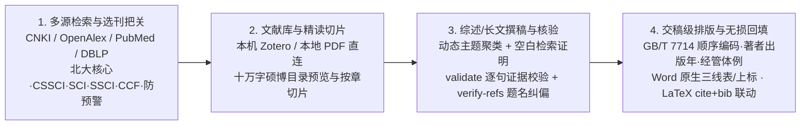

# Scholar Kit

[](https://github.com/lottshin/scholar-kit/actions/workflows/ci.yml)
[](https://github.com/lottshin/scholar-kit/actions/workflows/upstream-smoke.yml)
[](https://github.com/lottshin/scholar-kit/releases)
[](https://www.python.org/)
[](LICENSE)

面向科研全流程的学术文献检索与写作辅助 AI Skill。覆盖 **中英文检索 → 全文下载与本地库联动 → 引文追踪与文献综述 → 参考文献核验与排版 → 学术表达润色与文稿回填**，由确定性 Python 脚本负责检索、解析、核验与排版，Agent 负责学术理解与写作。

兼容 **Claude Code**、**Codex**、**Cursor**、**Antigravity**、**Gemini CLI** 等支持 `SKILL.md` 规范的 AI Agent。



---

## 快速安装

### 一句话安装（所有平台通用）

在任意 Agent 对话框发送：

```text
Fetch and follow instructions from https://raw.githubusercontent.com/lottshin/scholar-kit/main/setup.md
```

### 手动安装

<details>
<summary>展开各平台手动安装步骤</summary>

```bash
# Claude Code
git clone https://github.com/lottshin/scholar-kit ~/.claude/skills/scholar-kit

# Codex
git clone https://github.com/lottshin/scholar-kit ~/.codex/skills/scholar-kit

# Antigravity（全局或工作区）
git clone https://github.com/lottshin/scholar-kit ~/.gemini/config/skills/scholar-kit
# 或工作区内: git clone https://github.com/lottshin/scholar-kit .agents/skills/scholar-kit

# Cursor — macOS / Linux
git clone https://github.com/lottshin/scholar-kit ~/.cursor/skills/scholar-kit

# Cursor — Windows (PowerShell)
git clone https://github.com/lottshin/scholar-kit "$env:USERPROFILE\.cursor\skills\scholar-kit"

# Gemini CLI
gemini skills install https://github.com/lottshin/scholar-kit.git

# 多 Agent 共用建议：保留一份主仓库（如 ~/.agents/skills/scholar-kit），其余目录用 ln -s 软链接指向它

# 安装依赖并自检（兼容 PEP 668 受管环境，必要时自动引导 ~/.scholar-kit/.venv）
python3 -m pip install -r <安装路径>/scripts/requirements.txt
python3 <安装路径>/scripts/literature.py check --fix
```

</details>

---

## 怎么使用

安装后无需记忆命令行参数，直接用自然语言向 Agent 提需求：

```text
# 检索与下载
"帮我搜索近五年关于新质生产力的 CSSCI 论文，挑前 10 篇下载 PDF"
"在 PubMed 搜一下 CRISPR-Cas9 临床试验的高被引综述"

# 个人文献库联动（Zotero / 本地 PDF）
"从我电脑的 Zotero「博士论文」集合里找出所有数字经济文献，整理一份对比矩阵"
"把 ./mypapers 文件夹里的 PDF 导入课题库，写一段研究评述"

# 引文滚雪球与文献综述
"查一下赵涛《数字经济、创业活跃度与高质量发展》的引证文献和同被引文献"
"围绕这批文献生成文献综述初稿，并校验每一处引用是否有原文支撑"

# 参考文献纠偏、补页码与导出
"核对一下我文末这批中文参考文献，补齐漏掉的页码，顺便检查有没有改名搜不到的文献"
"按正文引用顺序导出 GB/T 7714 参考文献和兼容 pdflatex 的 BibTeX"

# 文稿润色与 Word / LaTeX 协同
"读取我的 draft.docx，按学术规范优化表达、去掉 AI 腔，确认无误后写回 Word"
```

---

## 核心能力（按科研工作流）

### 1. 多源文献检索与深层引文网络
- **知网深度检索**：支持 KNS8S 专业布尔检索式与多条件高级检索（篇关摘、第一作者、机构、基金、精确/模糊刊名、北大核心/CSSCI/CSCD/EI 等核心筛选、单页 50 条高吞吐与按下载量排序）；内置本地浏览器常驻热复用，免去多步操作反复冷启动。
- **国际与专业开放源并发 + 离线分区/预警识别**：支持单源检索、无结果自动降级（Fallback）及全源异步并发检索；内置 30,300+ 条 ISSN 离线索引，自动识别 **SCI / SSCI / A&HCI / ESCI、CCF-A/B/C（2026 第七版）及中科院《国际期刊预警名单》**（支持 `--core SCI,SSCI,CCF-A` 与 `--exclude-warning` 一键防踩雷）。
- **双向与共引图谱（滚雪球）**：中文论文可直接按知网链接或题名抓取**引证文献、参考文献、共引文献与同被引文献**；英文/DOI/arXiv 论文接入 Semantic Scholar 引文网络，检索结果可一键追加至课题库。

### 2. 全文下载与个人文献库管理
- **防风控批量下载**：支持知网 PDF/CAJ 分批并发下载、断点续传与格式严格分目录存放（可显式开启 CAJ 兜底，绝不静默混放），英文开放获取（OA）论文通过 Unpaywall 自动拉取，下载完成后自动生成排版清单。
- **本机 Zotero 与本地 PDF 零依赖直连**：自动以只读快照读取本机 `zotero.sqlite`（Zotero 运行中也不锁库）并关联本地 `storage/*.pdf` 附件；支持直接扫描导入本地 PDF 文件夹或 NoteExpress / Refworks / BibTeX 题录。
- **课题级文献库治理**：按课题隔离维护文献池，支持剔除噪声、精选留存、跨轮去重及阅读标签/批注沉淀。

### 3. 全文精读、综述生成与证据核查
- **本地优先全文与硕博长文按章切片**：已下载或 Zotero 关联的本地 PDF 直接离线秒级提取带页码正文（免网页滑块）；支持一键预览十万字硕博论文的章节目录与页码（`--toc`），并按标题或章号精准切片精读（如 `--section "研究设计,实证分析"`，自动过滤前置目录页并包含下辖子节）。
- **可追溯综述与选题分析**：基于检索语料真实关键词动态聚类，生成结构化综述证据包、研究趋势报告、文献对比矩阵与空白点检索证明，并对成稿中的 `[序号]` 引用逐句做证据支撑度校验。

### 4. 标准引用排版与错漏题录修复
- **顺序编码、著者-出版年制与经管顶刊体例**：脚本确定性输出 **GB/T 7714**（顺序编码制与**著者-出版年制**，支持中前英后汉语拼音排序、同作者同年 `2020a/2020b` 自动标引及正文内嵌引文生成）、**中文经管/社科顶刊体例**（《经济研究》《管理世界》书名号风格）、APA、MLA、Chicago、中文脚注、RIS、Excel，以及 **100% 纯 ASCII Citekey 的 BibTeX**（如 `zhao2020_glsj`，完美兼容传统 `pdflatex / bibtex`）。
- **卷期页码自动补齐与 Markdown / LaTeX 角标一键重排**：开放源原生保留卷期页码与出版商层级（`venue_tier`）；知网与 DOI 文献在导出或生成引用时自动单会话补全缺失页码（兼容单页短文与 `+` 转页页码）。支持 `cite --from-file draft.md --rewrite-output final.md` 单遍原子重排 `[序号]` 为 `[1]..[N]` 并附参考文献；支持 `cite --from-file draft.tex --rewrite-output main.tex --bibtex-output refs.bib` 自动替换为 `\cite{zhao2020_glsj}` 并导出精简 `.bib`。
- **二级题名真伪与改名核验（`verify-refs`）**：支持直接读取 `.docx / .md` 文稿末尾参考文献（`--from-file`），针对「英文回译词差」或「工作论文正式发表改名」导致按篇名搜不到的痛点，自动回退按**第一作者 + 核心词/期刊**检索作者真实成果并做相似度比对，一键修复真实发表题名与页码。

### 5. 学术表达优化与 Word / LaTeX 无损辅助
- **三步法学术润色**：读取 `.docx` / `.tex` / `.md` / `.txt` 段落与表格真实顺序锚点，严格按「审计 → 改写 → 变更报告」消除中文 AI 腔、强化论证衔接（判据见 [references/style-audit.md](references/style-audit.md)），不篡改任何数据、公式与引文。
- **Word 交稿级排版与安全打补丁**：`write-docx` 原生生成**学术三线表**（跨页自动重复表头）、**正文 `[1]` 顺序编码上标**、`摘要/关键词` 黑体+楷体规范样式、居中表题与页脚动态页码；`patch-docx` 支持按段落/表格锚点精确回填、插入原生 OOXML 脚注、整块替换旧参考文献（`replace_references`）及 `--dry-run` 零写入预检。

---

## 支持的数据源一览

| 数据源 | 覆盖范围 | 认证要求 | 特色支持 |
|--------|----------|----------|----------|
| **中国知网 (CNKI)** | 中文期刊、硕博学位论文、会议、报纸 | 检索免登；下载/全文需校园网、VPN 或 CARSI（支持 `auth-cnki` 一次登录全局复用） | 专业检索式、核心期刊筛选、全文提取、引证/参考/共引/同被引图谱 |
| **OpenAlex** | 全球全学科综合（2.5 亿+） | 免 Key | 原生卷期页码、高被引排序、OA 链接 |
| **Semantic Scholar** | 计算机、自然科学与社科 | 免 Key | 双向引文追踪、精确领域过滤、TLDR/摘要 |
| **PubMed (Europe PMC)** | 生物医学与生命科学 | 免 Key | 单次返回完整摘要、PMID/PMCID、卷期页码与 OA PDF |
| **arXiv** | 物理、数学、CS、定量金融预印本 | 免 Key | 最新预印本追踪、版本号标识与直接 PDF 链接 |
| **NSSD（国家哲社文献中心）** | 中文哲学社会科学开放期刊 | 免 Key | 免浏览器补充中文社科题录 |
| **DBLP** | 计算机科学顶会与期刊 | 免 Key | 精确会议/期刊卷期页码题录 |
| **BASE** | 全球学术机构知识库与 OA 资源 | 免 Key | 补充灰色文献与开放获取资源 |
| **本机 Zotero / 本地 PDF** | 个人已有文献积累 | 本地离线读取 | 只读快照不锁库，直接复用本地 PDF 全文与集合标签 |

> 另内置 **Crossref**（DOI 元数据与卷期页码补全）与 **Unpaywall**（合法开放获取 PDF 解析）。

---

## 状态分层与项目结构

Scholar Kit 将运行时数据分为两层，既避免切换项目重复登录知网，也不污染业务代码仓库：
- **全局共享目录 `~/.scholar-kit/`**（可通过环境变量 `SCHOLAR_HOME` 覆盖）：存放知网持久化浏览器登录态（`browser-profile/`、`cookies.json`）、跨项目检索与全文缓存（`cache/`、`fulltext/`）、可选虚拟环境（`.venv/`）与全局 `config.json`。
- **工作区会话目录 `./.scholar-kit/`**（自动生成 `.gitignore`）：仅存放当前项目的检索会话 `session.json`、多课题目录 `projects/<课题>/` 与项目级 `config.json`。

<details>
<summary>展开仓库目录结构</summary>

```text
scholar-kit/
├── SKILL.md                  ← Agent 核心指令与行为边界（渐进式披露）
├── setup.md                  ← 一句话自动安装脚本指引
├── README.md
├── LICENSE
├── references/               ← Agent 按需加载的领域参考知识
│   ├── workflows.md          ← 综述、引文推荐、Word 修补、对比矩阵步骤
│   ├── style-audit.md        ← 学术表达审计规则与去 AI 腔清单
│   ├── core-journals.md      ← 学科与核心期刊体系映射规则
│   ├── api-search-best-practices.md
│   ├── environment.md        ← 沙盒授权、浏览器热复用与网络排查
│   └── error-codes.md
├── scripts/                  ← 确定性工具层（Python >= 3.9）
│   ├── literature.py         ← 统一 CLI 路由入口
│   ├── config.py             ← 全局/工作区路径与配置优先级管理
│   ├── search.py             ← 八大开放/中文 API 检索与智能缓存
│   ├── search_async.py       ← 多源异步并发检索调度
│   ├── zotero.py             ← 本机 Zotero SQLite 快照与本地 API 读取器
│   ├── formatter.py          ← 多国标/著者出版年/经管体例引用排版、纯 ASCII BibTeX 与导出
│   ├── sections.py           ← 学术长文与硕博论文目录识别及按章节精准切片
│   ├── venues.py             ← 国际核心索引（SCI/SSCI/AHCI/CCF）与中科院预警期刊离线识别
│   ├── evidence.py           ← 课题库治理、动态聚类、综述证据包与论断核验
│   ├── docx_tools.py         ← Word/LaTeX/PDF 文稿读取、交稿级排版与 OOXML 安全补丁
│   ├── doctor.py             ← 环境自检、PEP 668 引导与缓存清理
│   ├── workflows.py          ← 标准化流水线模板
│   ├── smoke_upstream.py     ← 外部学术 API 每周线上契约巡检探针
│   └── cnki/                 ← 知网自动化模块（双引擎检索/详情/防风控下载/DOM 契约探针）
└── tests/                    ← pytest 自动化回归测试套件（96 项用例）
```

</details>

---

## 更新方式

```bash
git -C <安装路径> pull
python3 -m pip install -r <安装路径>/scripts/requirements.txt
```

运行 `check` 时也会自动检测远端是否有新版本提示。

## 免责声明与致谢

- 本工具仅供学术研究与教学辅助使用；使用知网相关能力须遵守 CNKI 服务条款并具备合法访问权限（校园网 / 机构 VPN / CARSI），本项目不提供任何绕过付费墙或验证码破解功能。
- 下载文献的著作权归原作者与出版机构所有。
- 学术表达优化模块（[references/style-audit.md](references/style-audit.md)）的审计框架改编自 [AIScientists-Dev/academic-humanizer](https://github.com/AIScientists-Dev/academic-humanizer)（MIT）与 [blader/humanizer](https://github.com/blader/humanizer)（MIT），针对中文学术语域与引用保真边界进行了重写；仅用于提升论证与语言质量，不针对任何查重或检测系统做规避。

## License

[MIT](LICENSE)
