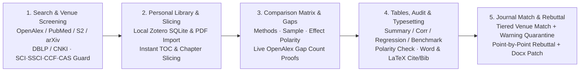

# Scholar Kit

[中文](README.md) | **English**

[](https://github.com/lottshin/scholar-kit/actions/workflows/ci.yml)
[](https://github.com/lottshin/scholar-kit/actions/workflows/upstream-smoke.yml)
[](https://github.com/lottshin/scholar-kit/releases)
[](https://www.python.org/)
[](LICENSE)

A full-lifecycle academic research AI Skill — **deterministic Python scripts act as the hands** (multi-source search, venue screening, PDF/thesis slicing, statistical tables, claim validation, citation formatting, and OOXML Word patching), while **your AI Agent acts as the brain** (synthesis, argumentation, and writing).

Compatible with **Claude Code**, **Codex**, **Cursor**, **Antigravity**, **Gemini CLI**, and any agent supporting the open `SKILL.md` Agent Skills specification.



---

## Quick Install

### Option 1: One-Line CLI Install (Agent Skills Ecosystem)

```bash
npx skills add lottshin/scholar-kit
```

### Option 2: Natural-Language Install (Any AI Agent)

Paste this prompt into Claude Code, Codex, Cursor, or Antigravity:

```text
Fetch and follow instructions from https://raw.githubusercontent.com/lottshin/scholar-kit/main/setup.md
```

### Option 3: Manual Git Clone

<details>
<summary>Expand platform-specific manual commands</summary>

```bash
# Claude Code
git clone https://github.com/lottshin/scholar-kit ~/.claude/skills/scholar-kit

# Codex
git clone https://github.com/lottshin/scholar-kit ~/.codex/skills/scholar-kit

# Antigravity (Global or Workspace)
git clone https://github.com/lottshin/scholar-kit ~/.gemini/config/skills/scholar-kit

# Cursor (macOS / Linux)
git clone https://github.com/lottshin/scholar-kit ~/.cursor/skills/scholar-kit

# Gemini CLI
gemini skills install https://github.com/lottshin/scholar-kit.git

# Install Python dependencies & verify (PEP 668 safe, auto-bootstraps ~/.scholar-kit/.venv if needed)
python3 -m pip install -r <install_path>/scripts/requirements.txt
python3 <install_path>/scripts/literature.py check --fix
```

</details>

---

## Usage Examples (Natural Language)

No CLI syntax required — just tell your agent what you need:

```text
# Literature search, offline indexing & snowballing
"Search OpenAlex and PubMed for high-impact SCI/SSCI papers on CRISPR clinical trials since 2022, excluding CAS warning journals."
"Pull all papers from my local Zotero 'PhD Chapter 2' collection and build a structured comparison matrix."
"Trace both citing and cited papers for DOI 10.1038/s41586-021-03819-2 and append them to project 'protein_folding'."

# Empirical & ML benchmark tables (Markdown / LaTeX booktabs / Word three-line .docx)
"Turn panel_data.csv into a Pearson correlation matrix with significance stars and export LaTeX booktabs + Word .docx."
"Format benchmark.csv as a LaTeX comparison table, automatically bolding best and underlining second-best metrics."

# Verification, citation formatting & manuscript QA
"Audit draft.docx against our project library for reversed claim polarity, year mismatches, and unbacked statistics."
"Rewrite inline citations in draft.tex to pure-ASCII \cite{key} commands and export a trimmed refs.bib."
"Verify the bibliography at the end of paper.docx, reconcile drifted working-paper titles, and fill missing page numbers."

# Journal matching & peer-review rebuttal
"Recommend Tier-1 flagship and Tier-2 core submission journals based on our references, quarantining CAS warning venues."
"Parse reviewer_comments.txt, match each point to paragraph anchors in manuscript.docx, draft a Response Letter, and prepare a dry-run docx patch."
```

---

## Live Output Previews

<details open>
<summary><strong>1. Publication-Ready Regression Table (<code>data-table --type regression</code> → Markdown, LaTeX <code>booktabs</code> &amp; Word Three-Line <code>.docx</code>)</strong></summary>

Table 3: Baseline OLS, IV-2SLS, and PSM-DID Estimates

| Variables | (1) Baseline OLS | (2) IV-2SLS | (3) PSM-DID |
| --- | ---: | ---: | ---: |
| Digital_Trans | 0.1426*** | 0.1685*** | 0.1358*** |
|  | (0.0312) | (0.0485) | (0.0341) |
| Firm_Size | 0.0834*** | 0.0791*** | 0.0812*** |
|  | (0.0215) | (0.0209) | (0.0224) |
| Leverage | -0.1942*** | -0.2105*** | -0.1870*** |
|  | (0.0748) | (0.0812) | (0.0785) |
| Firm FE / Year FE | Yes | Yes | Yes |
| Observations | 18420 | 18420 | 14210 |
| R² / Adj. R² | 0.2840 | 0.3170 | 0.3310 |

> Note: Computed with a pure-stdlib regularized incomplete beta Student-*t* two-tailed *p*-value engine (zero `scipy`/`pandas` dependency). Automatically exports clean LaTeX `booktabs` and full-width A4 Word three-line tables.

</details>

<details>
<summary><strong>2. Live Search-Verified Research Gaps &amp; Claim Polarity Audit (<code>review --verify-gaps</code> + <code>validate</code>)</strong></summary>

```json
// Live OpenAlex count probe blocks false "research gap" claims
{
  "dimension": "Empirical Coverage",
  "search_proof": {
    "database": "OpenAlex",
    "query": "digital transformation firm productivity empirical experiment",
    "year_range": "2022-2026",
    "total_hits": 31391,
    "verdict": "already_crowded"
  }
}

// Manuscript audit catches polarity reversal & unbacked statistical claims
{
  "status": "warning",
  "issues": [
    {
      "type": "polarity_conflict",
      "note": "Draft claims a positive effect, whereas the cited source reports a negative or inverted-U threshold effect (contradicted)."
    },
    {
      "type": "unbacked_statistics",
      "note": "Unattributed statistic detected (e.g., 73.6%, p < 0.01); verify primary data or pass --allow-primary-data."
    }
  ]
}
```

</details>

---

## Core Capabilities

1. **Multi-Source Search & Offline Quality Guard (`search`, `citations`)**
   - Supports **OpenAlex** (250M+ works), **Semantic Scholar**, **PubMed (Europe PMC)**, **arXiv**, **DBLP**, **BASE**, **NSSD**, and **CNKI** (with silent background warm browser reuse and inline bulk abstract export).
   - Ships a compressed **30,300+ ISSN offline index** (`scripts/venues.py`) covering **SCI / SSCI / A&HCI / ESCI**, **CCF-A/B/C (2026 7th ed.)**, and the **CAS Early Warning Journal List** (strictly separating active warnings from historically removed titles).
   - Bidirectional citation snowballing (`citing`, `cited`, `coref`, `cocited`) directly into isolated project libraries.
2. **Local Zotero & PDF Library Integration (`zotero`, `import`, `read-detail`)**
   - Reads local `zotero.sqlite` via read-only snapshot (never locks a running Zotero client) and links local PDF attachments automatically.
   - Instant table-of-contents preview (`--toc`) and chapter/section slicing (`--section`) for 100k-word dissertations and long PDFs.
3. **Structured Review Matrix & Deep Manuscript QA (`review`, `validate`, `verify-refs`)**
   - Extracts method, sample span, core finding sentence, and effect polarity (`positive`/`negative`/`nonlinear`/`insignificant`) per paper, flagging scholarly divergence within clusters.
   - Probes OpenAlex live (`--verify-gaps`) to attach verifiable hit counts and reject pseudo-gaps.
   - Audits `.md` / `.docx` / `.pdf` drafts for `polarity_conflict`, `year_mismatch`, and `unbacked_statistics`, and reconciles drifted working-paper titles (`verify-refs`).
4. **Empirical Tables, Citation Formatting & Submission Workflow (`data-table`, `cite`, `match-journal`, `rebuttal`, `write-docx`, `patch-docx`)**
   - `data-table`: Descriptive stats (`summary`), Pearson correlation matrices with `*/**/***` (`corr`), two-row econometric regression tables (`regression`), and ML benchmark tables auto-detecting lower-is-better metrics (`comparison`).
   - `cite` / `export`: Deterministic APA, MLA, Chicago, **GB/T 7714** (numeric & author-year), pure-ASCII `pdflatex`-safe BibTeX, RIS, Excel, plus atomic in-place `.md`/`.tex` renumbering.
   - `match-journal`, `rebuttal`, `format-audit` & `format-docx`: Tiered target venue recommendations with CAS warning quarantine; automated Reviewer comment parsing (`R1-C1`), manuscript `[Pn]` anchor linking, Response Letter generation, and dry-run verified `patch-docx` templates; plus non-destructive `.docx` thesis format auditing and styling from sample `.docx` templates, JSON, or natural-language specs.

---

## Supported Data Sources

| Source | Coverage | Auth Needed | Highlights |
|--------|----------|-------------|------------|
| **OpenAlex** | Multidisciplinary (250M+ works) | No API key | Volume/issue/pages, citation sorting, OA links |
| **Semantic Scholar** | CS, STEM, Social Sciences | No API key | Bidirectional citation graph, field filters, TLDR |
| **PubMed (Europe PMC)** | Biomedicine & Life Sciences | No API key | Full abstracts, PMID/PMCID, OA PDFs |
| **arXiv** | Physics, Math, CS, Q-Fin | No API key | Versioned preprints & direct PDF links |
| **DBLP** | Computer Science venues | No API key | Accurate conference/journal proceedings metadata |
| **BASE** | Global institutional OA repos | No API key | Grey literature & open-access repositories |
| **CNKI (知网)** | Chinese journals & theses | Free search; campus/VPN/CARSI for fulltext | Boolean expert search, Chinese core filters, thesis TOC & citation graph |
| **NSSD** | Chinese social science OA | No API key | Browser-free Chinese social science records |
| **Local Zotero / PDFs** | Personal research library | Local offline | Lock-free SQLite snapshot + fulltext extraction |

> Also integrates **Crossref** (DOI metadata/page completion) and **Unpaywall** (legal OA PDF resolution).

---

## State Isolation & Architecture

Runtime state is cleanly split so credentials stay shared while project libraries stay isolated:
- **Global (`~/.scholar-kit/`, overridable via `SCHOLAR_HOME`)**: caches, browser login profile, optional `.venv`, global `config.json`.
- **Workspace (`./.scholar-kit/`, auto-`.gitignore`d)**: per-project session libraries (`projects/<name>/session.json`) and workspace `config.json`.

Verified by a **104-test pytest suite** on GitHub Actions (`Ubuntu / macOS / Windows`, Python `3.9–3.12`) plus a weekly upstream API contract sentinel.

## Disclaimer & License

- Built strictly for legitimate academic research and educational workflows. Accessing institutional resources (e.g., CNKI) requires valid user authorization; this project never bypasses paywalls or CAPTCHAs.
- Style audit guidelines ([references/style-audit.md](references/style-audit.md)) adapt concepts from [AIScientists-Dev/academic-humanizer](https://github.com/AIScientists-Dev/academic-humanizer) (MIT) and [blader/humanizer](https://github.com/blader/humanizer) (MIT) for scholarly clarity, without targeting similarity/AI detectors.
- Licensed under the [MIT License](LICENSE).
